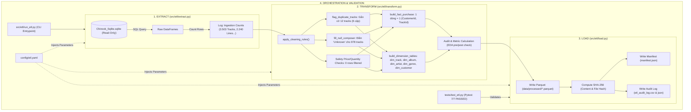

# TÀI LIỆU THIẾT KẾ KIẾN TRÚC ETL (ETL DESIGN SPECIFICATION)

**Dự án:** Gom cụm khách hàng theo sự quan tâm tới Track và Album  
**Giai đoạn:** PHA ETL - XÂY TẦNG DỮ LIỆU PHÂN TÍCH (Analytical Data Layer)  
**Tài liệu tham chiếu:** [reports/data_quality.md](file:///e:/ML/Chinook/reports/data_quality.md) & [reports/problem_selection.md](file:///e:/ML/Chinook/reports/problem_selection.md)  
**Tác giả:** Senior Data Engineer / Data Scientist  
**Trạng thái:** Sẵn sàng nghiệm thu (Ready for Review)  

---

## 1. Mục Tiêu & Nguyên Tắc Thiết Kế (Design Principles)

Mục tiêu cốt lõi của Pha ETL là chuyển đổi cơ sở dữ liệu quan hệ giao dịch OLTP (`data/Chinook_Sqlite.sqlite`) thành một tầng dữ liệu phân tích sạch (Analytical Data Layer / Star Schema) được tối ưu hóa cho mô hình hóa Machine Learning ở các pha tiếp theo (Pha C1), với các nguyên tắc bất biến:

1. **Tái lập hoàn toàn bằng một lệnh duy nhất (Single-Command Reproducibility):**
   - Chỉ cần chạy `python src/etl/run_etl.py`, toàn bộ quy trình từ kết nối SQLite ở chế độ Read-Only, trích xuất dữ liệu, làm sạch theo quy tắc, dựng schema sao, tính toán hash toàn vẹn, đến ghi ra định dạng Parquet và sinh manifest đều tự động thực thi.
2. **Không lọc dữ liệu ngầm (No Silent Filters):**
   - Mọi quy tắc lọc hay loại bỏ dữ liệu đều phải tách bạch thành các hàm độc lập có docstring rõ ràng, đi kèm công tắc bật/tắt trong file cấu hình [config/etl.yaml](file:///e:/ML/Chinook/config/etl.yaml).
   - Mỗi thao tác lọc đều phải ghi log chi tiết: lý do nghiệp vụ, số dòng bị ảnh hưởng, số khách hàng bị ảnh hưởng, và tác động tới các số liệu EDA đã công bố.
3. **Bảo tồn dữ liệu theo khuyến nghị Data Quality (Non-destructive Cleaning):**
   - Không tự ý xóa hay gộp 6 cặp track có cùng `(Name, AlbumId)` vì chúng có thời lượng (`Milliseconds`) và định dạng tệp khác nhau. Hệ thống chỉ gắn cờ kỹ thuật `is_duplicate_name_album = True`.
4. **Tính lũy đẳng tuyệt đối (Strict Idempotency):**
   - Pipeline chạy $N$ lần trên cùng một nguồn dữ liệu đầu vào và cùng cấu hình sẽ tạo ra chính xác các tệp đầu ra có cùng hash nội dung SHA-256.
5. **Đối soát tài chính & tính toàn vẹn 100% (Reconciliation & Integrity):**
   - Doanh thu và số lượng mua trong bảng sự kiện `fact_purchase` phải khớp từng xu với bảng `Invoice` và `InvoiceLine` gốc (trừ trường hợp cấu hình chủ động lọc và đã có audit log).

---

## 2. Sơ Đồ Luồng Pipeline ETL (Mermaid Diagram)

---

## 3. Kiến Trúc Dữ Liệu: Star Schema Phân Tích

Hệ thống tổ chức dữ liệu theo mô hình hình sao (Star Schema), tách bạch rõ ràng giữa bảng sự kiện đo lường hành vi giao dịch (`fact_purchase`) và các bảng chiều mô tả ngữ cảnh (`dim_*`).

### 3.1. Bảng Sự Kiện: `fact_purchase`
- **Hạt dữ liệu (Grain):** 1 dòng biểu diễn đúng 1 lượt mua một bài hát của một khách hàng: cặp duy nhất `(CustomerId, TrackId)`.
- **Tổng số dòng:** `2.240 dòng` (Khớp 100% với số dòng `InvoiceLine` gốc).
- **Tổng doanh thu:** `$2.328,60` (Khớp 100% với `SUM(Invoice.Total)` gốc).
- **Cấu trúc trường:**

| Tên Cột | Kiểu Dữ Liệu | Loại Khóa | Ý Nghĩa Nghiệp Vụ |
| :--- | :--- | :--- | :--- |
| `CustomerId` | `int64` | FK -> `dim_customer` | Định danh khách hàng mua nhạc (1 - 59) |
| `TrackId` | `int64` | FK -> `dim_track` | Định danh bài hát số được mua (1 - 3.503) |
| `InvoiceId` | `int64` | Degenerate FK | Hóa đơn giao dịch tương ứng |
| `InvoiceDate` | `datetime64[ns]` | Context Attribute | Thời điểm mua hàng (2009-01-01 đến 2013-12-22) |
| `UnitPrice` | `float64` | Measure | Đơn giá thực tế thanh toán (0.99$ hoặc 1.99$) |
| `AlbumId` | `int64` | FK -> `dim_album` | Album chứa bài hát (hỗ trợ phân tích giỏ hàng/album) |
| `ArtistId` | `int64` | FK -> `dim_artist` | Nghệ sĩ biểu diễn bài hát |
| `GenreId` | `int64` | FK -> `dim_genre` | Thể loại âm nhạc của bài hát |

### 3.2. Bảng Chiều: `dim_customer`
- **Hạt dữ liệu:** 1 dòng = 1 khách hàng (`CustomerId`).
- **Tổng số dòng:** `59 dòng` (Toàn bộ 59 khách hàng đều hoạt động).
- **Mục đích:** Lưu trữ thông tin nhân khẩu học và địa lý để **diễn giải cụm (Cluster Interpretation & Profiling)** sau khi phân cụm xong, **TUYỆT ĐỐI KHÔNG DÙNG LÀM ĐẶC TRƯNG HUẤN LUYỆN (ML FEATURES)** nhằm tránh rò rỉ hoặc thiên kiến địa lý.
- **Cấu trúc trường:** `CustomerId` (PK), `FirstName`, `LastName`, `Company`, `Address`, `City`, `State`, `Country`, `PostalCode`, `Phone`, `Fax`, `Email`, `SupportRepId`.

### 3.3. Bảng Chiều: `dim_track`
- **Hạt dữ liệu:** 1 dòng = 1 bản ghi bài hát trong catalog (`TrackId`).
- **Tổng số dòng:** `3.503 dòng`.
- **Cấu trúc trường:**
  * `TrackId` (PK), `Name`, `AlbumId` (FK), `MediaTypeId`, `GenreId` (FK), `Milliseconds`, `Bytes`, `UnitPrice`.
  * `Composer`: Nhạc sĩ sáng tác (giá trị NULL được điền chuỗi `'Unknown'`).
  * `is_duplicate_name_album`: `boolean` cờ kỹ thuật phát hiện 12 track (6 cặp) có cùng tên và cùng album nhưng khác dung lượng/thời lượng.
  * `is_sold`: `boolean` cờ xác định bài hát đã từng được mua ít nhất 1 lần (`True`: 1.984 tracks, `False`: 1.519 tracks).

### 3.4. Bảng Chiều: `dim_album`
- **Hạt dữ liệu:** 1 dòng = 1 album trong catalog (`AlbumId`).
- **Tổng số dòng:** `347 dòng`.
- **Cấu trúc trường:**
  * `AlbumId` (PK), `Title`, `ArtistId` (FK).
  * `total_tracks`: Tổng số bài hát catalog thuộc về album này (phục vụ tính tỷ lệ phủ album `coverage_ratio = purchased_tracks / total_tracks` trong Feature Engineering).
  * `is_sold`: `boolean` (`True`: 304 albums đã phát sinh doanh thu, `False`: 43 albums).

### 3.5. Bảng Chiều: `dim_artist` & `dim_genre`
- **`dim_artist` (275 dòng):** `ArtistId` (PK), `Name`, `total_albums`, `total_tracks`, `is_sold` (`True`: 165 nghệ sĩ, `False`: 110 nghệ sĩ).
- **`dim_genre` (25 dòng):** `GenreId` (PK), `Name`, `total_tracks`, `is_sold` (`True`: 24 thể loại, `False`: 1 thể loại - *Opera*).

---

## 4. Danh Mục Quy Tắc Làm Sạch & Lọc (Rule Catalog)

Tất cả các hàm làm sạch được xây dựng độc lập trong [src/etl/transform.py](file:///e:/ML/Chinook/src/etl/transform.py) và cấu hình qua [config/etl.yaml](file:///e:/ML/Chinook/config/etl.yaml).

| Mã Quy Tắc | Tên Hàm Xử Lý | Công Tắc Config (`config/etl.yaml`) | Trạng Thái Mặc Định | Số Dòng Ảnh Hưởng | Số Khách Ảnh Hưởng | Tác Động Tới Số Liệu EDA & Độ Thưa | Lý Do Nghiệp Vụ & Quyết Định |
| :---: | :--- | :--- | :---: | :---: | :---: | :---: | :--- |
| **R-01** | `flag_duplicate_tracks()` | `rules.flag_duplicate_tracks` | `true` | 12 tracks (6 cặp) | 0 | **Không đổi** (0 dòng bị xóa) | 6 cặp bài hát cùng `(Name, AlbumId)` nhưng khác thời lượng/dung lượng là các bản thu hoặc định dạng khác nhau. Chỉ gắn cờ `is_duplicate_name_album = True`, bảo tồn 100% catalog. |
| **R-02** | `fill_null_composer()` | `rules.fill_null_composer` | `true` | 978 tracks | 0 | **Không đổi** | 27.92% bài hát khuyết thông tin nhạc sĩ sáng tác. Điền `'Unknown'` để tránh lỗi xử lý chuỗi và phục vụ phân tích phụ trợ. |
| **R-03** | `filter_non_positive_prices()` | `rules.filter_non_positive_prices` | `true` | 0 dòng | 0 | **Không đổi** | Chốt an toàn ngăn chặn các bản ghi rác có `UnitPrice <= 0`. CSDL gốc 100% hợp lệ. |
| **R-04** | `filter_non_positive_quantities()` | `rules.filter_non_positive_quantities` | `true` | 0 dòng | 0 | **Không đổi** | Chốt an toàn ngăn chặn các dòng hóa đơn có `Quantity <= 0`. CSDL gốc 100% dòng có `Quantity = 1`. |
| **R-05** | `filter_unsold_tracks_from_dim()` | `rules.filter_unsold_tracks_from_dim` | `false` | 0 (tùy chọn) | 0 | **Không đổi** | Giữ toàn bộ 3.503 track trong `dim_track` để phục vụ phân tích toàn diện catalog, phân biệt qua cờ `is_sold`. Nếu bật `true`, `dim_track` sẽ chỉ còn 1.984 dòng đã bán. |
| **R-06** | `filter_media_type_ids()` | `rules.filter_media_type_ids` | `[]` | 0 (tùy chọn) | 0 | **Không đổi** | Cho phép lọc bỏ các định dạng video/audio đặc thù nếu cần. Mặc định giữ toàn bộ để đảm bảo đối soát doanh thu trọn vẹn. |
| **R-07** | `filter_zero_order_customers()` | `rules.filter_zero_order_customers` | `false` | 0 (tùy chọn) | 0 | **Không đổi** | Loại bỏ khách hàng không có đơn hàng. Trong Chinook 100% 59/59 khách hàng đều có phát sinh giao dịch. |

---

## 5. Cơ Chế Kiểm Thẩm & Đối Soát (Audit & Reconciliation)

Hệ thống thiết lập 4 tầng bảo vệ dữ liệu tự động tại [src/etl/load.py](file:///e:/ML/Chinook/src/etl/load.py):

1. **Đối soát số lượng và doanh thu (Row & Revenue Reconciliation):**
   $$\sum \text{InvoiceLine.UnitPrice} = \sum \text{Invoice.Total} = \sum \text{fact\_purchase.UnitPrice} = \$2.328,60$$
   $$\text{Count}(\text{InvoiceLine}) = \text{Count}(\text{fact\_purchase}) = 2.240\ \text{dòng}$$
2. **Kiểm tra tính duy nhất của khóa (Key Uniqueness):**
   - Đảm bảo trong `fact_purchase`, mỗi cặp `(CustomerId, TrackId)` chỉ xuất hiện đúng 1 lần (không có khách hàng nào mua lặp lại cùng 1 bài hát trong tập dữ liệu Chinook).
3. **Kiểm tra toàn vẹn tham chiếu (Referential Integrity):**
   - Mọi `CustomerId` trong `fact_purchase` phải thuộc `dim_customer`.
   - Mọi `TrackId` trong `fact_purchase` phải thuộc `dim_track`.
   - Mọi `AlbumId` trong `fact_purchase` phải thuộc `dim_album`.
   - Mọi `ArtistId` trong `fact_purchase` phải thuộc `dim_artist`.
   - Mọi `GenreId` trong `fact_purchase` phải thuộc `dim_genre`.
4. **Kiểm tra tính lũy đẳng qua SHA-256 (Manifest & Idempotency):**
   - Mọi lần chạy pipeline ghi nhận lại: `table_name`, `row_count`, `column_count`, `content_sha256`, `file_sha256`, `generated_at`, `config_hash`.
   - Khi chạy liên tiếp 2 lần với cùng cấu hình, hash nội dung của toàn bộ 6 bảng phân tích trùng khớp 100%.

---

## 6. Ma Trận Kiểm Thử Tự Động (Test Suite Matrix)

Tệp kiểm thử [tests/test_etl.py](file:///e:/ML/Chinook/tests/test_etl.py) thực thi qua pytest với kết quả xanh tuyệt đối (**7/7 PASSED**):

| Test Case | Mục Tiêu Kiểm Tra | Kết Quả Thực Tế |
| :--- | :--- | :---: |
| `test_reconciliation_total_rows_and_revenue` | Khớp tuyệt đối 2.240 dòng và $2.328,60 giữa raw SQLite và fact_purchase | **PASSED** |
| `test_keys_uniqueness_and_referential_integrity` | Cặp (CustomerId, TrackId) duy nhất; 100% FK trong fact hợp lệ trong dim | **PASSED** |
| `test_no_customer_loss_without_logging` | Đủ 59 khách hàng hoạt động; không có khách hàng bị biến mất | **PASSED** |
| `test_flagged_duplicate_tracks` | Đúng 12 tracks (6 cặp) mang cờ duplicate; 0 track bị xóa khỏi catalog | **PASSED** |
| `test_imputed_composer` | Đúng 978 tracks mang giá trị 'Unknown'; 0 giá trị NULL trong Composer | **PASSED** |
| `test_idempotency_run_twice` | Chạy pipeline 2 lần độc lập sinh ra bảng có cùng content_sha256 100% | **PASSED** |
| `test_manifest_schema_and_metadata` | Tệp manifest.json hợp lệ, đủ 6 bảng, hash, số dòng và metadata cấu hình | **PASSED** |
